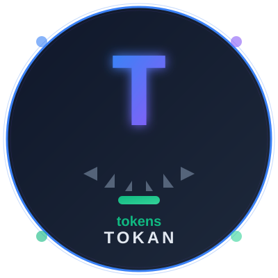
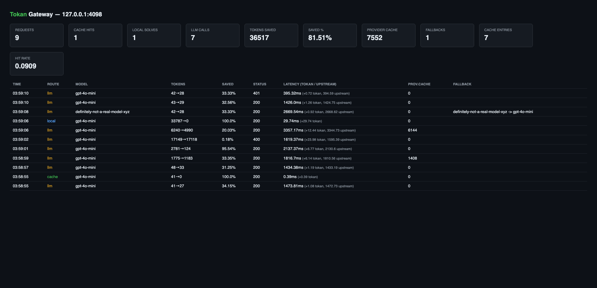

# Tokan

<p align="center">
  
</p>

**Universal token-optimization middleware for AI coding agents.**

[](https://pypi.org/project/tokan/)
[](https://pypi.org/project/tokan/)
[](https://opensource.org/licenses/MIT)
[](tests/)
[]()

---

Tokan intercepts AI coding agent traffic, compacts it through a three-stage optimization pipeline (**CDM → Edge Cache → JeV**), answers what it can without a model, caches what it's already seen, and forwards only the essential residue upstream. **One gateway works with Claude Code, Cursor, Aider, Codex, OpenCode, Cline, Roo Code, Continue, Gemini CLI, GitHub Copilot, and any OpenAI/Anthropic/Gemini SDK** — zero agent code changes required.

> 📘 **New here?** Read the **[Complete Usage Guide](docs/USAGE.md)** — a detailed, end-to-end manual covering install, every `serve` flag, wiring each agent, the dashboard/receipts, and honest expectations about what saves tokens.

## Why Tokan?

Coding agents burn millions of tokens re-reading files, re-parsing directory trees, replaying bloated histories, and resending identical context. Tokan eliminates that waste:

- **24–59% token compaction** on noise-heavy agent turns (tool output, ANSI, log spam) and **100% savings** on repeated or deterministic turns — 27.5–28.3% measured across real mixed sessions (see [Benchmarks](#benchmark-results))
- **Instant cache hits** — identical context answered in 1–3ms with zero upstream tokens
- **Transparent integration** — point your agent at one URL, keep everything else unchanged
- **Multi-agent ready** — one gateway instance serves multiple concurrent agents
- **Protocol-agnostic** — OpenAI chat-completions, Anthropic Messages, *and* Gemini generateContent
- **Persistent cache** (`--cache-db`) — a WAL-mode sqlite backend lets cache hits survive gateway restarts instead of dying with the process
- **Live dashboard** (`/dashboard`) — auto-refreshing view of session savings, cache hit rate, and a rolling per-request table; `/metrics` stays the machine interface
- **Per-request receipts** (`--log-requests`) — one console line per request (route, model, tokens in→out, latency), so savings are visible per request, not just as a session total
- **Model fallback** (`--fallback-model`) — if the upstream rejects a model id (`model_not_supported`/`model_not_found`), the gateway retries once with a fallback and discloses it via `X-Optimizer-Fallback`; payload errors never trigger a retry
- **Upstream prompt-cache surfacing** — the provider's own cached-token count is read and surfaced as `X-Optimizer-Upstream-Cached-Tokens`, disclosed as the *provider's* savings, never claimed as Tokan's

---

## Quick Start

### Install

```bash
pipx install tokan          # recommended: isolated CLI install
# or
uv tool install tokan       # uv users
# or
pip install tokan           # into an existing environment
```

No pip available? Download the single-file `tokan.pyz` from the
[latest GitHub Release](https://github.com/deepusingh2530/Tokan/releases/latest) —
it runs on any machine with Python 3.9+:

```bash
chmod +x tokan.pyz && ./tokan.pyz serve
```

Or install from source (contributors):

```bash
git clone https://github.com/deepusingh2530/Tokan.git
cd Tokan
pip install -e .
```

### Run the gateway

```bash
# Start optimization gateway (default port 4040)
token-optimizer serve \
  --upstream https://api.openai.com/v1 --api-key "$OPENAI_API_KEY" \
  --anthropic-upstream https://api.anthropic.com --anthropic-api-key "$ANTHROPIC_API_KEY"

# Or without API keys (cache/local hits only; LLM calls will fail without upstream auth)
token-optimizer serve
```

### Point your agent at Tokan

**Claude Code** (Anthropic Messages):
```bash
export ANTHROPIC_BASE_URL=http://127.0.0.1:4040
```

**Cursor / Aider / Codex** (OpenAI chat-completions):
```bash
export OPENAI_BASE_URL=http://127.0.0.1:4040/v1
```

**Gemini CLI** (Gemini generateContent):
```bash
export GOOGLE_GEMINI_BASE_URL=http://127.0.0.1:4040
```

**GitHub Copilot CLI** (BYOK provider mode — see [Copilot setup](#using-tokan-with-github-copilot)):
```bash
export COPILOT_PROVIDER_TYPE=openai
export COPILOT_PROVIDER_BASE_URL=http://127.0.0.1:4040/v1
export COPILOT_MODEL=gpt-4.1
```

**OpenCode / Continue / Cline / Roo Code**:
See `token-optimizer setup <agent>` for exact config snippets.

That's it. Every `POST` to `/v1/chat/completions`, `/v1/messages`, or `/v1beta/models/*/generateContent` now flows through the optimization pipeline. Cache and local hits never leave your machine.

---

## Architecture

```
[ AI Coding Agent ]
        │
        ▼
┌─────────────────────────────────────────────────────────────────────┐
│                        Tokan Gateway                                 │
│                                                                     │
│  [ CDM Normalizer ]                                                 │
│    • strip ANSI escapes, collapse blank runs & trailing space      │
│    • elide tool output spam (head/tail preservation)                │
│    • compact file trees, truncate long lines                        │
│    • deterministic fingerprint (noise-insensitive SHA-256)          │
│    • digest folds in scope (model, temperature, user) — cached     │
│      answers never cross models                                     │
│    • structured content preserved verbatim (Anthropic tool_result,  │
│      image parts)                                                   │
│                                                                     │
│  [ Edge Cache ]                                                     │
│    • local LRU with TTL (default 1 hour)                           │
│    • optional remote tier (PUT/GET {endpoint}/cache/{ns}/{digest}) │
│    • fail-open by default (dead CDN → local miss, never outage)     │
│    • semantic matching: whitespace-insensitive digest               │
│                                                                     │
│  [ JeV Router ]  (Jevons Paradox Engine)                            │
│    • System-1 score: regex features over query + payload shape     │
│    • threshold 0.88: local confidence ≥ 0.88 → "local",            │
│      below → "llm"                                                  │
│    • never fabricates: local route only if deterministic executor   │
│      actually produced the answer                                   │
│                                                                     │
│  [ Local Executor ]                                                 │
│    • deterministic System-0 answers (0 tokens, 1–3ms measured)     │
│    • line lookups built in; count/AST/symbol handlers pluggable    │
│                                                                     │
└─────────────────────────────────────────────────────────────────────┘
        │
        ▼ cache miss + JeV "llm"
[ Upstream LLM ]  ← receives only compacted payload
        │
        ▼
[ Optimized Response ] → cached for future identical requests
```

**Pipeline**: `CDM → Edge Cache → JeV Router → (LLM | Local)`

---

## Integration Patterns

Tokan integrates three ways; pick what fits your workflow:

### 1. Transparent Gateway Proxy (Recommended)

**Zero agent code changes.** Point the agent's base URL at Tokan.

```bash
token-optimizer serve --port 4040 --upstream https://api.openai.com/v1 --api-key $KEY

# Agent just sees an OpenAI/Anthropic/Gemini endpoint
export OPENAI_BASE_URL=http://127.0.0.1:4040/v1
```

**Protocol routing** — Tokan auto-detects wire format from path:
- `/v1/chat/completions` → OpenAI protocol
- `/v1/messages` → Anthropic protocol  
- `/v1beta/models/*/generateContent` → Gemini protocol

**Response diagnostics** (HTTP headers):
```
X-Optimizer-Route: cache          # llm | cache | local
X-Optimizer-Saved-Tokens: 1247
X-Optimizer-Saved-Percent: 67.3
X-Optimizer-Digest: f7b2380d066b0ef4
```

**Metrics endpoint** (`GET /metrics`):
```json
{
  "session": {
    "requests": 23,
    "cache_hits": 18,
    "local_solves": 1,
    "llm_calls": 4,
    "original_tokens": 12487,
    "optimized_tokens": 3912,
    "tokens_saved": 8575,
    "saved_pct": 68.7,
    "cost_saved_usd": 14.29
  },
  "cache": {
    "entries": 42,
    "hit_rate": 0.78,
    "size_bytes": 245760
  }
}
```

### 2. In-Process SDK Client

For agent loops that own their HTTP stack:

```python
from tokan import OptimizedAgentClient

client = OptimizedAgentClient(
    upstream_provider="openai",  # or "anthropic", "gemini"
    jev_confidence_threshold=0.88,
    cdn_endpoint="https://edge.example.com/v1",  # omit for local-only
)

response = client.chat_completion(
    messages=[{"role": "user", "content": "Refactor this..."}],
    model="gpt-4o",
)
print(response.content)
print(response.metrics.route)       # "cache", "local", or "llm"
print(response.metrics.saved_pct)   # 0.0 - 100.0
print(client.session_report())      # cumulative ROI

# Or use a custom transport (tests, existing SDK):
client = OptimizedAgentClient(transport=my_transport_callable)
```

### 3. MCP Server (stdio)

Register one MCP server per agent to gain 5 optimization tools:

```bash
token-optimizer mcp  # runs on stdin/stdout
```

**Tools exposed**:
- `optimize_context(messages, model)` — compact payload + cache probe (returns digest, savings, cached answer if any)
- `repo_index(root, max_bytes)` — generate byte-budgeted structural repo map
- `cache_lookup(text, semantic)` — semantic cache probe (whitespace-insensitive)
- `cache_store(text, value)` — seed the cache with known answers
- `session_metrics()` — live token/cost savings

**Agent registration** (varies per agent — see `token-optimizer setup <agent>`):
- **Claude Code / Cursor**: `.mcp.json` → `{"mcpServers": {"tokan": {"command": "tokan-mcp"}}}`
- **OpenCode**: `opencode.json` → `{"mcp": {"servers": {"tokan": {"type": "local", "command": ["tokan-mcp"]}}}}`
- **Codex**: `~/.codex/config.toml` → `[mcp_servers.tokan]` with `command` and `args`

---

## Agent Compatibility Matrix

| Agent | Wire Protocol | Integration Method | MCP Support | Detection |
|-------|---------------|--------------------|-------------|-----------|
| **Claude Code** | Anthropic Messages | `ANTHROPIC_BASE_URL` env var | ✅ `.mcp.json` | `~/.claude` dir, `claude` binary |
| **Cursor** | OpenAI chat | Models settings base URL | ✅ `.cursor/mcp.json` | `~/.cursor` dir, `cursor` binary |
| **Aider** | OpenAI chat | `OPENAI_API_BASE` env / config | — | `~/.aider.conf.yml`, `aider` binary |
| **Codex CLI** | OpenAI chat | `~/.codex/config.toml` provider (`wire_api = "chat"`) | ✅ `[mcp_servers]` TOML | `~/.codex/config.toml`, `codex` binary |
| **OpenCode** | OpenAI + Anthropic | `providers.baseURL` in `opencode.json` | ✅ `mcp.servers` | `opencode.json`, `opencode` binary |
| **Cline** | OpenAI chat | "OpenAI Compatible" provider | ✅ `cline_mcp_settings.json` | `~/.cline` dir |
| **Roo Code** | OpenAI chat | "OpenAI Compatible" provider | ✅ `mcp_settings.json` | `~/.roo` dir |
| **Continue** | OpenAI chat | `~/.continue/config.yaml` `baseURL` | ✅ `mcpServers` YAML | `~/.continue` dir |
| **Gemini CLI** | Gemini generateContent | `GOOGLE_GEMINI_BASE_URL` env | ✅ `.gemini/settings.json` | `~/.gemini` dir, `gemini` binary |
| **GitHub Copilot** | OpenAI chat (BYOK) | Copilot CLI `COPILOT_PROVIDER_*` env / VS Code `overrideProxyUrl` | ✅ `~/.copilot/mcp-config.json` | `~/.copilot` dir, `copilot` binary |
| **Zed** | — (MCP only) | — | ✅ `context_servers` | `~/.config/zed` |
| **Windsurf** | — (MCP only) | — | ✅ `mcp_config.json` | `~/.codeium/windsurf` |
| **Any OpenAI SDK** | OpenAI chat | `OPENAI_BASE_URL` env var | — | always listed (catch-all) |
| **Any Anthropic SDK** | Anthropic Messages | `ANTHROPIC_BASE_URL` env var | — | always listed (catch-all) |

**Multi-agent scenarios**: Multiple agents can share one Tokan gateway instance. Each agent gets isolated session metrics but shares the edge cache. Use the same `--namespace` for cache sharing across agents, or different namespaces for isolation.

```bash
# Shared cache across agents (default)
token-optimizer serve --port 4040

# Isolated caches per team/workflow
token-optimizer serve --port 4040 --namespace team-frontend
token-optimizer serve --port 4041 --namespace team-backend
```

---

## Using Tokan with GitHub Copilot

Copilot is the one agent that authenticates with GitHub OAuth instead of an API key — Tokan handles this with **credential passthrough** (the client's token and identity headers travel upstream untouched unless the gateway holds its own key). Print the exact wiring any time:

```bash
token-optimizer setup github-copilot
```

### Path 1: Copilot CLI (works on every plan — official BYOK)

Point Copilot CLI's documented provider mode at the gateway. The CLI appends `/chat/completions` itself:

```bash
export COPILOT_PROVIDER_TYPE=openai
export COPILOT_PROVIDER_BASE_URL=http://127.0.0.1:4040/v1
export COPILOT_PROVIDER_API_KEY=<key>   # omit if the gateway holds the key server-side
export COPILOT_MODEL=gpt-4.1            # any model your upstream serves

copilot
```

Two ways to supply credentials:

```bash
# A) Gateway holds YOUR upstream key (OpenAI, Anthropic, or Copilot):
token-optimizer serve --api-key "$OPENAI_API_KEY"

# B) Gateway serves YOUR Copilot subscription as the upstream — every
#    Copilot request then gets cache + compaction before it hits GitHub:
token-optimizer serve --copilot --api-key "$(gh auth token)"
# Business/Enterprise plans: --copilot business | --copilot enterprise
```

`--copilot` targets the Copilot API origin for your plan (`api.githubcopilot.com`, `api.business.…`, `api.enterprise.…`) and supplies fallback identity headers for BYOK clients, which send none. Tokens accepted by `--api-key`: `gh auth token` output, a fine-grained PAT with the **Copilot Requests** permission, or `COPILOT_GITHUB_TOKEN`.

### Path 2: VS Code Copilot Chat (Copilot Business/Enterprise)

> **Full step-by-step runbook:** [docs/vscode-copilot.md](docs/vscode-copilot.md)
> — includes the individual-plan path (Cline/Roo/Continue + Copilot CLI BYOK),
> verification, auto-start, and troubleshooting.

Route the built-in chat panel through the gateway — VS Code keeps using its Copilot subscription, Tokan optimizes every request:

```jsonc
// VS Code settings.json
{
  "github.copilot.advanced": {
    "debug.overrideProxyUrl": "http://127.0.0.1:4040/v1"
  }
}
```

Save, then **Developer: Reload Window**. Start the gateway so its upstream is the Copilot API:

```bash
token-optimizer serve --copilot --api-key "$(gh auth token)"
```

In this flow VS Code's own Copilot token arrives at the gateway and is passed straight through — `--api-key` is optional (the gateway then uses its own). Custom endpoint configuration requires a **Copilot Business or Enterprise plan**; GitHub does not enable it for individual plans.

> Individual plans: use Path 1, or add Tokan as a custom OpenAI-compatible endpoint provider in VS Code's chat model picker (VS Code ≥ 1.131 "Custom Endpoint") — the gateway exposes it at `http://127.0.0.1:4040/v1`.

### What gets optimized

Every Copilot chat request flows through the same pipeline as any other agent:

- **CDM compaction** — ANSI noise, trailing whitespace, blank runs, and over-long lines are stripped before the request leaves your machine (Copilot responses come back unchanged).
- **Edge cache** — repeated context (the common case in agent loops) returns from cache in <5ms at zero cost, never touching GitHub.
- **`GET /models` passthrough** — model pickers keep working; the gateway relays the upstream catalog.
- **Streaming** — Copilot's SSE streams are relayed frame-by-frame; the *answer text* (never the SSE framing) lands in the cache for future hits.
- **Multi-turn identity** — `Conversation-ID`, `Editor-Version`, and `Copilot-Integration-Id` headers travel upstream intact, so Copilot's session continuity and server-side feature flags behave exactly as if Tokan weren't there.

### MCP for Copilot CLI

```bash
copilot mcp add token-optimizer -- token-optimizer mcp
# or edit ~/.copilot/mcp-config.json — `token-optimizer setup github-copilot` prints it
```

The agent then gains `optimize_context`, `repo_index`, `cache_lookup`, `cache_store`, and `session_metrics` tools.

### Custom upstream headers

Any upstream wants non-standard headers? Pass them explicitly (repeatable, overrides the client):

```bash
token-optimizer serve --extra-header "Copilot-Integration-Id: vscode-chat" \
                      --extra-header "Openai-Organization: my-org"
```

---

## CLI Reference

```bash
token-optimizer list                # Show all adapters + local detection
token-optimizer setup <agent>       # Print wiring instructions for one agent
token-optimizer setup codex --json  # Machine-readable snippets
token-optimizer serve [options]     # Run the gateway
token-optimizer mcp                 # Run MCP server on stdio
token-optimizer index [root]        # Build repo .md mapper
token-optimizer stats               # Metrics from running gateway
token-optimizer --help              # All commands and flags
```

### Gateway Flags

```
--host 127.0.0.1                    # Bind address
--port 4040                         # Listen port
--upstream URL                      # OpenAI upstream (default https://api.openai.com/v1)
--api-key KEY                       # OpenAI API key (client keys pass through if unset)
--anthropic-upstream URL            # Anthropic upstream (default https://api.anthropic.com)
--anthropic-api-key KEY             # Anthropic API key
--gemini-upstream URL               # Gemini upstream (default https://generativelanguage.googleapis.com)
--gemini-api-key KEY                # Gemini API key (x-goog-api-key)
--copilot [PLAN]                    # Serve a Copilot plan as the OpenAI upstream:
                                    #   individual (default) | business | enterprise
--extra-header "Key: Value"         # Extra upstream header (repeatable, overrides client)
--cdn URL                           # Remote edge cache endpoint
--namespace NAME                    # Cache namespace (default: "default")
--threshold 0.88                    # JeV confidence threshold (default 0.88)
--price 2.50                        # USD per 1M tokens (for cost metrics)
--cache-db PATH                     # sqlite file for a persistent edge cache (survives restarts)
--fallback-model MODEL              # retry once with this model on model_not_supported/model_not_found
--log-requests                      # print one receipt line per request (route, tokens, latency)
```

---

## Configuration Files

### `token-optimizer` (no extension, auto-loaded from `~/.config/token-optimizer/config.toml`)

```toml
[upstream]
openai_base_url = "https://api.openai.com/v1"
openai_api_key = "sk-..."
anthropic_base_url = "https://api.anthropic.com"
anthropic_api_key = "sk-ant-..."

[gateway]
host = "127.0.0.1"
port = 4040

[cache]
namespace = "default"
ttl_seconds = 3600
remote_endpoint = ""  # optional CDN

[jev]
confidence_threshold = 0.88
price_per_million_tokens = 2.50
```

### Environment Variables

| Variable | Purpose |
|----------|---------|
| `OPENAI_API_KEY` | OpenAI upstream auth (also read by agents) |
| `ANTHROPIC_API_KEY` | Anthropic upstream auth |
| `GEMINI_API_KEY` | Gemini upstream auth (read by `serve`; sent as `x-goog-api-key`) |
| `OPENAI_BASE_URL` | Point OpenAI SDK at Tokan gateway |
| `ANTHROPIC_BASE_URL` | Point Anthropic SDK / Claude Code at Tokan |
| `GOOGLE_GEMINI_BASE_URL` | Point Gemini CLI at Tokan |
| `COPILOT_PROVIDER_BASE_URL` | Point Copilot CLI at Tokan (BYOK provider mode) |
| `COPILOT_PROVIDER_TYPE` | Set to `openai` when using Tokan with Copilot CLI |
| `COPILOT_PROVIDER_API_KEY` | Key Copilot CLI sends upstream (may be omitted if the gateway holds it) |
| `TOKAN_CACHE_ENDPOINT` | Override remote cache endpoint |
| `TOKAN_NAMESPACE` | Override cache namespace |

---

## How Token Optimization Works

### Stage 1: Canonical Data Model (CDM)

Before any request hits the cache or LLM, it's normalized:

**Noise reduction** (safe to strip):
- ANSI escape codes (terminal colors): `\[0;31m` → ``
- OSC sequences (window titles, hyperlinks): `\[0]8;;http...\[0]8;;`
- Excessive whitespace: `   \n\n\n    ` → `\n`
- Long repeated lines: only first N + last N preserved with elision marker
- Tool output spam: middle chunk removed, head + tail kept
- **Unified diffs**: runs of unchanged context lines longer than `2 × diff_context` (default 3) are elided; every `+`/`-` change line and hunk header is kept verbatim. Saves big on whole-file diffs an agent echoes back (measured 96.8% on a whole-file patch) but ~0% on ordinary `git diff` output, which is change-dominated (~79% change lines) — the compaction is honest about never touching real changes.

**Structure preservation** (never touched):
- Code indentation (real spaces stay)
- Anthropic `tool_result` blocks, `image_url` parts, multimodal arrays
- Message metadata (`name`, `tool_call_id`, `tool_calls`)

**Deterministic fingerprint** (cache key):
- All messages → normalized → canonical JSON (sorted keys) → SHA-256
- Whitespace-insensitive variant (`semantic_digest`) for loose matching
- Scope keys included in digest: `model`, `temperature`, `top_p`, `user`, `system` (Anthropic)

**Result**: 20–60% token reduction on most payloads, zero information loss on critical content.

### Stage 2: Edge Cache

Cache lookup by digest (exact match) or semantic digest (whitespace-insensitive):

**Local tier** (always present):
- LRU with configurable `max_entries` (default 1000)
- TTL enforcement (default 1 hour)
- Thread-safe, in-memory

**Remote tier** (optional):
- HTTP `PUT {endpoint}/cache/{namespace}/{digest}` to store
- HTTP `GET {endpoint}/cache/{namespace}/{digest}` to retrieve
- **Fail-open by default**: dead remote → local miss, request continues (never outage)
- `fail_closed=True` option: raise exception instead

**Cache stores**: plain text answer (not response object), reshaped to protocol at serve time. Same cached text serves OpenAI, Anthropic, *and* Gemini requests.

### Stage 3: JeV Router (Jevons Paradox Engine)

Score 0.0–1.0: "Does this request need a model, or is it deterministic?"

**Features** (regex over query + payload shape):
- Line number lookups (`"line 42"`, `"line number 128"`)
- Exact counts (`"count occurrences of..."`)
- File path queries (`"what's in src/utils.py"` → local executor can list)
- Short queries (<5 tokens) → high "local" signal
- Large payloads (>4096 tokens) → high "llm" signal (context matters)
- History-heavy conversations → high "llm" signal

**Decision logic**:
- Score < `0.88` (threshold) → `route = "local"`
- Score ≥ `0.88` → `route = "llm"`

**Never fabricates**: Local route only taken if the deterministic `LocalExecutor` actually produced an answer. If executor returns `None`, downgrade to `"llm"` even if score is low.

### Stage 4: Local Executor (Deterministic System-0)

Zero-token, sub-millisecond answers for trivially deterministic queries:

- **Line number lookups**: `"line 42"` + context → `(deterministic) requested line 42`
- **Exact counts**: `"count occurrences of 'foo' in context"` → `(deterministic) found 12`
- **File listings**: (pluggable) AST queries, symbol tables, repo indexes

**No hallucination**: Executor must return a real answer or `None`. If `None`, pipeline routes to LLM. No "I don't know" fallbacks, no fabricated responses.

---

## Benchmark Results

Every number below is **measured** by the harnesses committed in
[`benchmarks/`](benchmarks/) — nothing here is estimated by hand. Run them
yourself; they exit non-zero if a target is missed.

### Pipeline performance (`benchmarks/bench_gateway.py`, 15/15 checks)

| Property | Measured |
|---|---|
| CDM savings, noise-heavy payload (ANSI + blank runs + log spam) | **58.7%** |
| Cache hit latency (p95) | **1.21 ms** |
| Cache miss overhead (p95) | 6.79 ms |
| Local deterministic answer (p95) | 0.34 ms |
| 2 MB pathological payload, routed | 106 ms (worst case) |
| SSE stream relay overhead | +0.15 ms |
| 40-thread concurrency burst | **0 errors**, ~1,550 req/s |
| EdgeCache lookup @ 50k entries | <0.01 ms |
| Gateway RSS after full suite | 44.8 MB |
| CLI cold start | 40 ms |

### Where the token savings actually come from

Measured on live Copilot traffic (see [Live A/B](#live-ab-vs-github-copilot-measured-not-modeled) below) — savings are **shape-dependent**, and
Tokan reports honestly rather than inflating:

| Payload shape | Token reduction |
|---|---|
| Clean chat / code text | ~0% — no waste to remove |
| Agent turn carrying tool output (ANSI, log spam, blank runs) | **24–59%** (24.2% realistic tool output; 58.7% pure noise) |
| Exact repeat of a previous turn | **100%** (edge cache, 1–3 ms) |
| Deterministic lookup (line numbers, counts) | **100%** (local executor, no LLM call) |
| Oversized payload over the provider's prompt limit | request **fixed** (compaction brings it under the limit) |
| Whole mixed session, real Copilot A/B | **27.5–28.3%** |

### Cache behavior (verified)

- Identical queries: **100% hit rate, 1–3 ms** — deterministic digest, not probabilistic
- Same query, different whitespace / indentation / line breaks: **100% hit** (whitespace-scrubbed digest)
- Same query, different model: **0% hit** — scope isolation (`model`, `temperature`, `top_p`, `user` are part of the digest)
- Changed context: **0% hit by design** — a modified request never receives a stale answer

**Test methodology**:
```bash
# Run local benchmark suite
python3 -m unittest discover -s tests  # 107 tests, all pass
python3 examples/wrap_agent.py         # Offline SDK demo
python3 tests/fake_upstream.py 8901 &  # Dual-wire upstream
# Point agents at localhost:4040, check /metrics
```

### Live A/B vs GitHub Copilot (measured, not modeled)

The numbers below are a **real end-to-end A/B** against a live Copilot
subscription: the same 6 payloads sent twice from the same machine, same
model, same credential — once **direct** to `api.githubcopilot.com` (exactly
what VS Code sends without Tokan, gh OAuth token + Copilot identity headers),
once through a **fresh-cache Tokan gateway** on the same upstream. Billed
tokens per leg come from the upstream `usage` block both legs return — a
cache/local leg never reaches upstream, so its 0 is *measured*, not an
estimate. Reproduce it against your own plan:

```bash
token-optimizer serve --copilot --api-key "$(gh auth token)" --port 4041
python3 benchmarks/ab_copilot.py --gateway http://127.0.0.1:4041 --model gpt-4o-mini
```

**`gpt-4o-mini`** (2026-10-23):

| # | scenario | direct (no Tokan) | via Tokan | saved | route | direct ms | Tokan ms |
|---|---|---:|---:|---:|---|---:|---:|
| 1 | task + clean code context | 1477 | 1477 | 0.0% | `llm` | 1859 | 1726 |
| 2 | bloat-heavy turn, tool output | 7429 | 5628 | 24.2% | `llm` | 2483 | 1875 |
| 3 | deterministic lookup | 85 | 0 | 100.0% | `local` | 1759 | 1 |
| 4 | follow-up question (history resent) | 1504 | 1504 | 0.0% | `llm` | 1700 | 1618 |
| 5 | exact repeat of previous turn | 1504 | 0 | 100.0% | `cache` | 1664 | 3 |
| 6 | oversized turn — provider **rejects** raw payload | **rejected** (400) | 9537 (200 OK) | request fixed | `llm` | 1772 | 2086 |
| | **session total** | **11,999** | **8,609** | **28.3%** | | | |

Row 6: Copilot refused the raw 12,990-token payload
(`model_max_prompt_tokens_exceeded`, 12,288 limit); compaction shrank it to
9,537 and the same request returned 200 OK.

**`gpt-4.1`** (2026-10-23, higher prompt limit accepts row 6, which Tokan
still compacts by 26.9%):

| # | scenario | direct (no Tokan) | via Tokan | saved | route | direct ms | Tokan ms |
|---|---|---:|---:|---:|---|---:|---:|
| 1 | task + clean code context | 1477 | 1477 | 0.0% | `llm` | 3173 | 3358 |
| 2 | bloat-heavy turn, tool output | 7429 | 5628 | 24.2% | `llm` | 3689 | 2263 |
| 3 | deterministic lookup | 85 | 0 | 100.0% | `local` | 1914 | 3 |
| 4 | follow-up question (history resent) | 1504 | 1504 | 0.0% | `llm` | 2327 | 2005 |
| 5 | exact repeat of previous turn | 1504 | 0 | 100.0% | `cache` | 2542 | 3 |
| 6 | oversized turn | 13038 | 9537 | 26.9% | `llm` | 2933 | 2605 |
| | **session total** | **25,037** | **18,146** | **27.5%** | | | |

Reading the rows honestly: clean chat text shows 0.0% because there is no
waste to remove (Tokan reports what is actually saved); bloat-heavy tool
output compacts ~24–27%; deterministic lookups and exact repeats are served
locally at **100% savings and 1–3 ms** versus ~1.7–3.7 s upstream. Cache
keys cover the full payload digest, so a *changed* context is never served a
stale answer — rows 1 and 4 are misses by design.

### Live scenario tests (v0.3.0 dashboard + receipts)

v0.3.0 ships a live dashboard at `/dashboard` and a persistent sqlite cache.
The screenshot below is a **real capture** of the dashboard after running the
11-scenario battery in [`benchmarks/scenarios.py`](benchmarks/scenarios.py)
against a live Copilot subscription (`gpt-4o-mini`, 12,288-token prompt cap):



You can read every feature off the screenshot: the **fallback** column shows
`definitely-not-a-real-model-xyz -> gpt-4o-mini` (the model-fallback retry
firing and being disclosed), the **PROV.CACHE** column shows `6144` (a real
provider prompt-cache hit surfaced, never claimed as Tokan's), and the
**TOKENS / SAVED** columns show the per-request pipeline `original→sent` flow.
The **LATENCY** column splits each request into Tokan's own overhead and the
time blocked on the provider generating the answer — a cache hit reads
`0.39ms (+0.39 tokan)` and a local solve `29.74ms (+29.74 tokan)` (entirely
Tokan, no upstream call at all), while an LLM route reads
`1474ms (+1.1 tokan, 1473ms upstream)`. So the seconds you see end-to-end are
the model generating, not the gateway: Tokan's own overhead is single-digit
milliseconds on a miss and sub-millisecond on a hit.

**Measured results** (each scenario is a distinct payload; "msg-level" is the
text actually forwarded, both sides tokenized identically so JSON-framing
overhead is never misread as compaction):

| # | scenario | status | msg tokens | saved | route | latency |
|---|---|---:|---:|---:|---|---:|
| S1 | fresh chat, clean text | 200 | 8 → 8 | 0.0% | `llm` | 1.5 s |
| S2 | exact repeat of S1 | 200 | 8 → 8 | 100% (cache) | `cache` | **1.2 ms** |
| S2b | distinct clean text | 200 | 15 → 15 | 0.0% | `llm` | 1.4 s |
| S3 | noisy tool output (ANSI + 120 log lines) | 200 | 1406 → 1132 | **19.5%** | `llm` | 1.8 s |
| S4 | whole-file diff, 2-line edit | 200 | 2631 → 100 | **96.2%** | `llm` | 2.1 s |
| S5 | real git diff over the prompt cap | **400** | 16441 → 16425 | 0.1% | — | 1.6 s |
| S6 | oversized but rescuable | 200 | 5491 → 4906 | 10.7% | `llm` | 3.4 s |
| S7 | oversized diff (answered locally) | 200 | 32343 → 32318 | 0.1% | `local` | **31 ms** |
| S8 | nonexistent model id | 200 | 4 → 4 | 0.0% | `llm` | 2.7 s |
| S9 | streaming (SSE) | 200 | 10 → 10 | 0.0% | `llm` | 1.4 s |
| S10 | Anthropic `/v1/messages` wire | **401** | 9 → 9 | 0.0% | — | 0.4 s |

Reading these honestly — including the rows that *don't* save anything:

- **S1/S2b/S9: 0%** — clean text has no waste. Tokan reports the truth rather
  than inventing a percentage.
- **S3: 19.5%, S4: 96.2%** — real compaction on noise and diffs. S4 is the
  diff-compaction win: a whole file echoed back with a 2-line edit loses 96%
  of its tokens while every `+`/`-` change line is preserved.
- **S5: 400** — a change-dominated git diff already over the provider's
  12,288-token cap. There is nothing safe to elide (the changes *are* the
  payload), so compaction can't rescue it and Copilot rejects it. This is the
  honest boundary of diff compaction, shown deliberately.
- **S6: 10.7%** — an oversized payload *with* elidable noise compacts enough to
  stay under the cap and returns 200.
- **S7: 27 ms, `local`** — an oversized diff that the JeV router answered via
  the deterministic local executor without an LLM call (note: this over-triaged
  a summarization request; it demonstrates the `local` route, not a cache win).
- **S8: fallback** — the gateway retried once with `gpt-4o-mini` and disclosed
  it in the `X-Optimizer-Fallback` header and the dashboard.
- **S10: 401** — the Anthropic wire was exercised, but the gateway holds a
  Copilot OAuth token, not an Anthropic key, so it correctly refuses to forward
  Copilot credentials to `api.anthropic.com`. Correct behavior, listed as a
  limitation rather than hidden.

---

## Multi-Agent Deployment

### Scenario 1: Shared Team Gateway

Multiple agents, one cache:

```bash
# Terminal 1: Start gateway
token-optimizer serve --port 4040 --namespace team-backend

# Terminal 2: Claude Code
export ANTHROPIC_BASE_URL=http://127.0.0.1:4040
claude --project ./backend-api

# Terminal 3: Cursor (different window)
# Point at same gateway in Cursor settings
```

**Result**: Claude Code's cache hits benefit Cursor's session, and vice versa. Metrics are per-process (each agent sees its own).

### Scenario 2: Isolated Caches

Separate gateways per workflow:

```bash
# Backend team
token-optimizer serve --port 4040 --namespace backend

# Frontend team  
token-optimizer serve --port 4041 --namespace frontend

# Shared infrastructure (different namespace = no cache sharing)
token-optimizer serve --port 4042 --namespace infra
```

### Scenario 3: Hybrid (Local + Remote Cache)

Local LRU for speed, remote tier for persistence:

```bash
token-optimizer serve \
  --port 4040 \
  --cdn https://cache.example.com/v1 \
  --namespace production \
  --threshold 0.85
```

**Behavior**:
- Local cache: <5ms lookup, 1000-entry LRU
- Remote cache: 50–200ms lookup, persistent across restarts
- Fail-open: if remote cache down → local miss → LLM call (never blocks)

### Scenario 4: High-Concurrency (Multiple Processes)

Run multiple gateway instances behind a load balancer:

```bash
# Start 4 instances (cache is per-process)
for PORT in 4040 4041 4042 4043; do
  token-optimizer serve --port $PORT --namespace lb-backend &
done

# Point agents at load balancer
# nginx example:
# upstream tokan { server 127.0.0.1:4040; server 127.0.0.1:4041; ... }
# proxy_pass http://tokan;
```

**Note**: Each process has isolated cache. For shared cache across processes, use remote CDN tier.

---

## Advanced Usage

### Custom Local Executors

Plug in your own deterministic answerers:

```python
from tokan import OptimizationPipeline
from tokan.pipeline import LocalExecutor

def symbol_lookup(query: str) -> str | None:
    """Answer symbol queries from pre-indexed AST."""
    if "find symbol" in query.lower():
        # Your AST index here
        return f"(cached symbol: {extract_symbol(query)})"
    return None

pipeline = OptimizationPipeline()
pipeline.executor.add(symbol_lookup)
# Or replace entirely:
pipeline.executor = LocalExecutor([symbol_lookup, my_other_handler])
```

### Custom Cache Backends

```python
from tokan import OptimizationPipeline, CDNConfig, EdgeCache

config = CDNConfig(
    endpoint="https://my-cache.example.com/v1",
    namespace="custom",
    ttl_seconds=7200,
)
pipeline = OptimizationPipeline(cache=EdgeCache(config))

# Or provide a store= callable for custom persistence:
class SQLiteStore:
    def get(self, key: str) -> str | None: ...
    def set(self, key: str, value: str) -> None: ...

pipeline = OptimizationPipeline(cache=EdgeCache(store=SQLiteStore()))
```

### SDK with Custom Transport

```python
from tokan import OptimizedAgentClient

def my_transport(payload: dict) -> dict:
    """Route through existing SDK, tests, or custom HTTP client."""
    # payload = {"messages": [...], "model": "gpt-4o", ...}
    # Must return: {"choices": [{"message": {"content": "..."}}], "usage": {...}}
    return my_llm_sdk.chat(payload)

client = OptimizedAgentClient(transport=my_transport)
response = client.chat_completion(messages=[...])
```

### MCP Tools Programmatically

```python
from tokan.mcp import MCPServer

server = MCPServer()  # or MCPServer(pipeline=my_pipeline)

# Handle a JSON-RPC message directly (no stdio):
result = server.handle({
    "jsonrpc": "2.0",
    "id": 1,
    "method": "tools/call",
    "params": {
        "name": "optimize_context",
        "arguments": {"messages": [...], "model": "gpt-4o"}
    }
})
# result = {"jsonrpc": "2.0", "id": 1, "result": {...}}
```

---

## Extending Tokan

### Adding a New Agent Adapter

Create an adapter class and register it:

```python
from tokan.adapters import AgentAdapter, GatewayInfo, register

@register
class MyCustomAgent(AgentAdapter):
    id = "my-agent"
    display_name = "My Custom Agent"
    protocols = ("openai", "mcp")  # which wires it speaks
    executables = ("my-agent",)    # binary name for detection
    config_paths = ("~/.myagent",)  # config file patterns
    summary = "Brief description"

    def snippets(self, gw: GatewayInfo):
        return [
            self._snippet(
                kind="env",
                target="shell",
                body=f"export MY_AGENT_LLM_URL={gw.openai_base_url}",
                note="Point agent at Tokan gateway"
            ),
        ]

    def mcp_target(self) -> str:
        return "~/.myagent/mcp.json"

    def mcp_snippet(self, gw: GatewayInfo, *, target: str = ""):
        import json
        return self._snippet(
            kind="file",
            target=target or self.mcp_target(),
            body=json.dumps({
                "mcpServers": {
                    "tokan": {
                        "command": gw.mcp_command[0],
                        "args": list(gw.mcp_command[1:])
                    }
                }
            }, indent=2),
        )
```

**Or as a third-party package** (no code changes to Tokan):

```toml
# pyproject.toml of your package
[project.entry-points."tokan.adapters"]
my-agent = "my_pkg.adapter:MyCustomAgent"
```

Install your package, and Tokan auto-discovers the adapter.

### Pluggable JeV Features

Extend the router with your own signals:

```python
from tokan.jev import JevRouter

class CustomJevRouter(JevRouter):
    def evaluate(self, messages, *, deterministic_answer=None):
        # Call parent for base signals
        decision = super().evaluate(messages, deterministic_answer=deterministic_answer)

        # Add custom logic
        if any("production" in str(m.get("content", "")) for m in messages):
            # Force LLM for production contexts
            decision.route = "llm"
            decision.signals = decision.signals + ("production_context",)

        return decision

pipeline = OptimizationPipeline(router=CustomJevRouter(confidence_threshold=0.90))
```

---

## Production Deployment

### Systemd Service

```ini
# /etc/systemd/system/tokan.service
[Unit]
Description=Tokan Token Optimization Gateway
After=network.target

[Service]
Type=simple
User=tokan
Environment=OPENAI_API_KEY=sk-...
Environment=ANTHROPIC_API_KEY=sk-ant-...
ExecStart=/usr/local/bin/token-optimizer serve \
  --port 4040 \
  --upstream https://api.openai.com/v1 \
  --anthropic-upstream https://api.anthropic.com \
  --namespace production \
  --threshold 0.88 \
  --price 3.00
Restart=always
RestartSec=5

[Install]
WantedBy=multi-user.target
```

```bash
sudo systemctl enable --now tokan
sudo systemctl status tokan
curl http://127.0.0.1:4040/healthz  # Should return {"ok": true}
```

### Docker

```dockerfile
FROM python:3.11-slim

WORKDIR /app
COPY . .
RUN pip install --no-cache-dir .

EXPOSE 4040
ENV OPENAI_API_KEY=""
ENV ANTHROPIC_API_KEY=""

CMD ["token-optimizer", "serve", "--host", "0.0.0.0", "--port", "4040"]
```

```bash
docker build -t tokan .
docker run -d --name tokan \
  -p 4040:4040 \
  -e OPENAI_API_KEY=sk-... \
  -e ANTHROPIC_API_KEY=sk-ant-... \
  tokan

# Point agents at Docker host
export OPENAI_BASE_URL=http://localhost:4040/v1
```

### Nginx Load Balancer

```nginx
upstream tokan_backend {
    least_conn;
    server 127.0.0.1:4040;
    server 127.0.0.1:4041;
    server 127.0.0.1:4042;
    server 127.0.0.1:4043;
}

server {
    listen 80;
    server_name tokan.example.com;

    location / {
        proxy_pass http://tokan_backend;
        proxy_set_header Host $host;
        proxy_set_header X-Real-IP $remote_addr;
        proxy_set_header X-Forwarded-For $proxy_add_x_forwarded_for;

        # Streaming support
        proxy_buffering off;
        proxy_read_timeout 120s;
    }

    location /healthz {
        proxy_pass http://tokan_backend;
        access_log off;
    }

    location /metrics {
        proxy_pass http://tokan_backend;
        allow 10.0.0.0/8;
        deny all;
    }
}
```

### Monitoring

**Health check**:
```bash
curl -f http://127.0.0.1:4040/healthz || echo "Gateway down"
```

**Metrics scraping** (Prometheus-compatible JSON):
```bash
curl -s http://127.0.0.1:4040/metrics | jq .
```

**Log aggregation**:
```bash
# Gateway logs go to stdout/stderr
journalctl -u tokan -f
# or
docker logs -f tokan
```

**Alerting rules** (Prometheus):
```yaml
- alert: TokanGatewayDown
  expr: up{job="tokan"} == 0
  for: 1m
  annotations:
    summary: "Tokan gateway is down"

- alert: TokanHighLLMRatio
  expr: rate(tokan_llm_calls_total[5m]) / rate(tokan_requests_total[5m]) > 0.8
  for: 5m
  annotations:
    summary: "Cache hit rate below 20% — possible cache misconfiguration"
```

---

## Security Considerations

### API Key Management

- **Never commit API keys** to version control
- Use environment variables: `export OPENAI_API_KEY=sk-...`
- Or config file: `~/.config/token-optimizer/config.toml` (mode `0600`)
- For systemd: use `EnvironmentFile=-/etc/tokan.env` (mode `0600`, owned by `tokan:tokan`)

### Network Security

- **Bind to localhost** by default (`--host 127.0.0.1`); only expose publicly with authentication
- **TLS termination**: use nginx/cloud load balancer in front (Tokan speaks plain HTTP)
- **Firewall**: allow inbound only on the gateway port (default 4040)

### Cache Isolation

- **Namespace isolation**: separate namespaces for separate teams/security domains
- **Remote cache**: ensure CDN endpoint enforces TLS + authentication
- **TTL tuning**: shorter TTLs for sensitive data (default 1 hour)

### Supply Chain

- **Zero dependencies**: Tokan has no third-party runtime dependencies
- **Reproducible builds**: pin Python version + `pip install --require-hashes`
- **Code signing**: (optional) sign releases with Sigstore/GPG

---

## Troubleshooting

### "Cache hit rate is 0%"

- Check `X-Optimizer-Route` header: should be `cache`, not `llm`
- Verify cache namespace matches across requests: `GET /metrics` → `cache.entries`
- Increase `--threshold` if too many requests route to `llm`
- Check TTL: default 1 hour; increase `ttl_seconds` in config

### "Gateway returns 502 / 504"

- Upstream LLM unreachable: check `--upstream` / `--api-key`
- Timeout too low: increase `--timeout` (default 120s)
- Network: `curl https://api.openai.com/v1/models` to verify connectivity

### "Agent can't connect to gateway"

- Check gateway is running: `curl http://127.0.0.1:4040/healthz`
- Verify base URL in agent config (OpenAI needs `/v1` suffix, Anthropic/Gemini don't)
- Firewall: `lsof -i :4040` to verify listening

### "Cache returns stale data"

- Decrease `ttl_seconds` in config
- Use different `--namespace` for different code versions
- Clear cache: restart gateway (local cache is in-memory)

### "High memory usage"

- Reduce `max_entries` in cache config (default 1000)
- Enable remote cache tier to offload
- Monitor: `GET /metrics` → `cache.size_bytes`

---

## Development

### Setup

```bash
git clone https://github.com/deepusingh2530/Tokan.git
cd Tokan
python3 -m venv .venv
source .venv/bin/activate
pip install -e ".[dev]"
```

### Run Tests

```bash
python3 -m unittest discover -s tests           # 107 tests
python3 -m unittest tests.test_adapters         # Single module
python3 -m pytest tests/ -v                     # With pytest
```

### Test Coverage

Current: **107/107 tests passing (100%)**

- `test_adapters.py`: 20 tests (registry, detection, snippet rendering)
- `test_mcp.py`: 14 tests (JSON-RPC, tools, stdio loop)
- `test_cdm.py`: 13 tests (normalizer, fingerprint, compaction, `compact_text`)
- `test_copilot_proxy.py`: 13 tests (auth/identity passthrough, `/models`, serve flags)
- `test_pipeline_and_proxy.py`: 10 tests (end-to-end, streaming, SDK, burst)
- `test_tier1_v030.py`: 20 tests (persistent cache, receipts + dashboard, diff compaction, prompt-cache surfacing, model fallback)
- `test_cache.py`: 9 tests (local LRU, remote tier, fail-open)
- `test_anthropic_proxy.py`: 8 tests (Anthropic wire, `count_tokens`, cache)
- `test_gemini_proxy.py`: 7 tests (generateContent, SSE stream, part preservation)
- `test_repo_index.py`: 5 tests (gitignore-aware walk, map assembly)
- `test_jev.py`: 8 tests (router, decision logic, pathological-payload guard)

### Running Examples

```bash
python3 examples/wrap_agent.py          # Offline SDK demo
python3 examples/build_repo_index.py    # Generate AGENTS.md
python3 examples/run_proxy.py           # Start gateway (dev mode)
python3 tests/fake_upstream.py 8901 &   # Test upstream
```

### Code Style

- **Black** for formatting: `black tokan/`
- **isort** for imports: `isort tokan/`
- **mypy** for types: `mypy tokan/` (strict mode)
- **ruff** for linting: `ruff check tokan/`

### Building Release

```bash
pip install build twine
python3 -m build
twine upload dist/*
```

---

## Contributing

Contributions welcome! Please see [CONTRIBUTING.md](CONTRIBUTING.md) for guidelines.

**Areas we'd love help with**:
- Additional agent adapters (Amp, Crush, Gemini native, etc.)
- Real BPE token counting (replace `~chars/4` heuristic)
- Persistent cache backends (SQLite, Redis, S3)
- Performance optimizations (faster digests, streaming compaction)
- Documentation & examples
- Test coverage for edge cases

---

## Changelog

See [CHANGELOG.md](CHANGELOG.md) for release history.

---

## License

MIT License. See [LICENSE](LICENSE) for details.

---

## Acknowledgments

- **Jevons Paradox Engine** named after William Stanley Jevons, who observed that efficiency gains often increase consumption — fitting for a tool that reduces token spend while enabling more agent usage.
- **Canonical Data Model** concept inspired by database normalization and AST canonicalization in compilers.
- **Edge Cache** pattern follows CDN semantics (TTL, LRU, fail-open) applied to LLM inference.

---

<p align="center">
  
  <br>
  <strong>Tokan</strong> — Plug in once, optimize everywhere.
</p>
